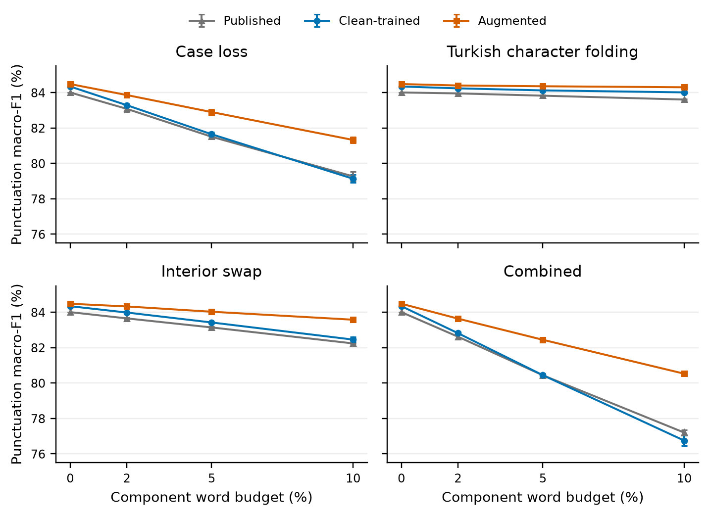
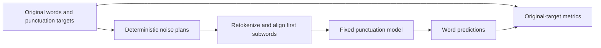

# Turkish Punctuation Restoration under Writing Noise

**A controlled robustness study of casing loss, Turkish character folding, and
typing errors.** CMPE 586 course project by **Kagan Can**.

[](https://github.com/kckagancan/cmpe586-turkish-punctuation/actions/workflows/repository-checks.yml)

[Read the paper](output/pdf/turkish-punctuation-report.pdf) ·
[Full results](docs/held-out-test-results.md) ·
[Methods and evidence](docs/README.md) ·
[Reproduce the report](report/README.md)

How much does a punctuation model rely on clean spelling and capitalization?
This project compares a published Turkish punctuation BERT with matched clean
and noise-augmented BERTurk fine-tuning, then removes case loss from augmentation
to examine its contribution. All completed results, including unfavorable
ablation differences, are retained.

## Main finding

Noise augmentation improves robustness in this fixed experiment while giving a
small positive clean-test macro-F1 difference.

| Held-out punctuation macro-F1 (%) | Published reference | Clean-trained | Augmented | Augmented − clean (pp) |
| --- | ---: | ---: | ---: | ---: |
| Clean | 84.0071 | 84.3437 | **84.4824** | +0.1387 |
| Case loss, heavy | 79.2674 ± 0.2516 | 79.1340 ± 0.2251 | **81.3246 ± 0.1641** | +2.1906 ± 0.0618 |
| Combined, heavy | 77.2021 ± 0.1631 | 76.7502 ± 0.3021 | **80.5289 ± 0.0906** | +3.7787 ± 0.2191 |

Primary cohort: **14,600 rows / 181,485 original word targets**. Noisy values are
means ± sample SD over **three corruption seeds** for fixed trained models.
Paired gains are computed per seed. There is **one training seed**, so these SDs
do not measure training uncertainty or establish statistical significance.



The case-loss removal arm uses the same training budget and remaining noise
plans. Retaining case loss improves matched medium/seed586 case-loss F1 by
**0.9585 pp** and combined F1 by **0.8799 pp**. Small folding/swap differences
favor removal. Its omitted budget is **not redistributed**, so this is a
component-removal study with less total noise, not an equal-dose component ranking.

## What is controlled?

- **Training:** same saved initialization, eligible rows, row order, optimizer,
  and 3 epochs / 10,968 updates for clean, augmented, and removal arms.
- **Selection:** highest clean-validation punctuation macro-F1; all arms select
  epoch 3. Noisy validation and test scores select no checkpoints.
- **Noise:** deterministic case loss, Turkish letter folding, one adjacent
  interior swap, and their composition; 2/5/10% single-family word budgets.
- **Alignment:** preserve every word ID and target; retokenize changed words;
  supervise first subwords and ignore padding/continuations with `-100`.
- **Evaluation:** 117 main validation conditions; five new ablation conditions
  with 15 reused references; a frozen **122-condition held-out matrix**.
- **Sensitivity:** exclude 155 exact train/validation input matches using the
  same predictions, yielding **244 cohort score sets** without extra inference.



Combined noise has a **larger union coverage** than each component: heavy means
10% per family, about 27.32% changed test words at seed586. Full-loss endpoints
are reported separately. The primary metric equally averages PERIOD, COMMA,
and QUESTION_MARK F1; O positions still count toward errors.

## Explore without downloading models or data

The [paper PDF](output/pdf/turkish-punctuation-report.pdf),
[complete result tables](docs/held-out-test-results.md),
[aggregate CSV](docs/held-out-test-aggregates.csv),
[supports/confusion matrices](docs/held-out-test-condition-summary.json), and
[fixed diagnostics](docs/held-out-test-diagnostics.csv) are in this repository.

With Python 3.11+, these checks use the standard library only:

```bash
git clone https://github.com/kckagancan/cmpe586-turkish-punctuation.git
cd cmpe586-turkish-punctuation
python scripts/build_report_tables.py --check
python scripts/check_repository.py
```

They verify public report bindings and repository hygiene. They do not rerun
training, inference, or the historical unit suite. [Report build instructions](report/README.md)
explain PDF reproduction; [experiment reproduction](docs/reproduction.md)
describes the separately held inputs, exact recipes, GPU requirements, and archives.

## Repository map

| Path | Contents |
| --- | --- |
| [`report/`](report/) | Editable NeurIPS preprint source, generated tables, source bindings |
| [`output/pdf/`](output/pdf/) | Public report PDF |
| [`docs/`](docs/README.md) | Current results/methods and dated research records |
| [`src/turkish_punctuation/`](src/turkish_punctuation/) | Shared noise, alignment, training, inference, metrics |
| [`configs/`](configs/README.md) | Frozen experimental recipes and model identities |
| [`notebooks/`](notebooks/) | Colab orchestration; execution switches off and outputs cleared |
| [`scripts/`](scripts/) | Preparation, verification, analysis, and reporting entry points |
| [`data/`](data/README.md), [`artifacts/`](artifacts/README.md) | Documentation only; actual data/models/results are ignored |

## Scope and limitations

This is a single-architecture, single-training-seed study of defined synthetic
noise, with a fixed compute budget. It does not establish convergence, broad
natural-noise performance, or a state-of-the-art result. The published checkpoint
is an external reference with uncontrolled training history.

Dataset licensing, exact split provenance, document independence, and published-model
prior test exposure remain unresolved. The exact-input sensitivity filter does
not resolve these issues. The held-out plan was frozen after validation development;
it is **validation-informed**, not a blind preregistration. Future test-informed
changes are exploratory. See the [paper](output/pdf/turkish-punctuation-report.pdf)
and [protocol](docs/held-out-test-protocol.md) for the complete limitations.

Data, weights, raw examples/predictions, private course metadata, and run receipts
are excluded from Git. Source URLs/hashes and aggregate evidence are published.
Historical config status strings are retained to preserve frozen identities;
[PROJECT_STATUS.md](PROJECT_STATUS.md) gives the current state.

## Credit and citation

Original project code and documentation are available under [MIT](LICENSE).
External data, model assets and the NeurIPS template retain their separate terms.

Data/published model: [Kurt & Çayır (2023)](https://github.com/uygarkurt/Turkish-Punctuation-Restoration).
Base encoder: [BERTurk](https://github.com/stefan-it/turkish-bert).
The paper cites the noise and evaluation literature used in this project;
[third-party notices](THIRD_PARTY_NOTICES.md) distinguish their terms from our artifacts.
AI assistance supported development and writing, as disclosed in the paper.
Use [CITATION.cff](CITATION.cff) to cite this project.

Türkçe: Bu proje, Türkçe noktalama modellerinin kontrollü yazım bozulmalarındaki
dayanıklılığını inceler. Rapor İngilizcedir; ayrıntılı yöntem ve deney kayıtları
doküman dizininde korunur. Geliştirme ortamı: [PROJECT_SETUP.md](PROJECT_SETUP.md).
