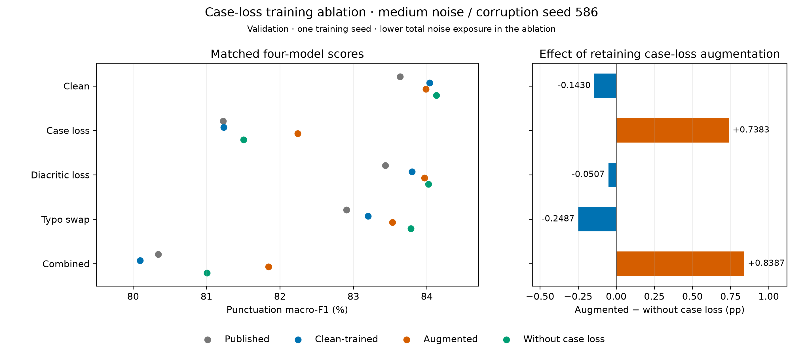

# Case-loss training ablation: verified validation results

Completed **2026-10-22**, with five new GPU evaluations and 15 matching saved
reference results. Local verification independently recomputed all 20 metrics
against **14,453 validation records / 179,164 word targets per condition**.

## Main finding

Removing case loss from augmented training lowers macro-F1 by
**0.7383 pp under case loss** and **0.8387 pp under
combined noise**, while clean F1 rises **0.1430 pp**.
The observed effect is specific to this recipe and one training seed; the
removed word budget was not redistributed, so total training noise is lower.

## Matched four-model comparison

All noisy rows are **medium / corruption seed 586**, not the three-seed means
from the earlier [full grid](robustness-grid-results.md). F1 is a percentage;
differences are percentage points. The primary metric averages PERIOD, COMMA
and QUESTION_MARK, excluding O from that average while retaining O in counts.

| Condition | Published | Clean-trained | Augmented | Without case loss | Without − augmented (pp) |
| --- | ---: | ---: | ---: | ---: | ---: |
| Clean | 83.6366 | 84.0365 | 83.9881 | 84.1310 | +0.1430 |
| Case loss | 81.2256 | 81.2344 | 82.2428 | 81.5045 | -0.7383 |
| Diacritic loss | 83.4347 | 83.7975 | 83.9694 | 84.0201 | +0.0507 |
| Typo swap | 82.9044 | 83.2000 | 83.5331 | 83.7818 | +0.2487 |
| Combined | 80.3439 | 80.0965 | 81.8435 | 81.0048 | -0.8387 |

The ablation is slightly better on clean text, diacritic loss and typo swaps in
this realization. Full augmentation performs better on case loss and combined
noise. The ablation still exceeds clean training by **0.9083 pp** on
combined noise; removing the casing component does not erase every observed
augmentation gain. These differences are not statistical significance or
equivalence claims.

## Robustness relative to each model's own clean anchor

A positive drop is worse. The ablation starts from a slightly higher clean score;
reporting its own clean-to-noisy drop preserves that distinction.

| Noise | Augmented clean-to-noisy drop | Without-case-loss drop | Extra drop without case loss |
| --- | ---: | ---: | ---: |
| Case loss | 1.7453 | 2.6265 | +0.8813 |
| Diacritic loss | 0.0186 | 0.1109 | +0.0923 |
| Typo swap | 0.4550 | 0.3492 | -0.1058 |
| Combined | 2.1446 | 3.1262 | +0.9816 |

## Punctuation classes

Values below are **without-case-loss minus full-augmentation per-class F1 (pp)**.
All original precision/recall/F1, supports and confusion counts remain in the
ignored saved reports; the accompanying aggregate CSV retains class P/R/F1.

| Condition | Period ΔF1 | Comma ΔF1 | Question ΔF1 |
| --- | ---: | ---: | ---: |
| Clean | +0.0041 | -0.0496 | +0.4743 |
| Case loss | -0.1110 | -1.9012 | -0.2027 |
| Diacritic loss | +0.0632 | -0.0846 | +0.1735 |
| Typo swap | +0.0654 | +0.2006 | +0.4801 |
| Combined | -0.0800 | -2.0047 | -0.4314 |

For combined noise, comma recall is **55.7004%**
with full augmentation and **52.1187%** without
case loss; comma precision is **66.6566%** and
**67.1396%**, respectively. Report both
when interpreting the comma F1 difference.

## Fixed method and limitations

The three fine-tuned models use the same initial tensors, training rows, row
order, update budget and numerical recipe. The ablation preserves row masks
and retained typo/diacritic word operations, omitting case loss only. Each model
selected **epoch 3 / 10,968 updates by clean validation**. No noisy ablation
score selected a checkpoint or changed a hyperparameter. The published model is
an external reference with a different training history.

Inference uses the same Tesla T4, FP32 SDPA/math, deterministic settings,
batch 16, clean-length order and unchanged shared numerical/data source hashes
as the completed reference grid. A fresh GPU clean control is used for each
model. [Evaluation gates and execution](case-loss-ablation-evaluation.md).

There is **one training seed (586)** and **one corruption seed (586)** in this
ablation comparison. No error bars or training-seed stability claims are made.
Removing a component also lowers total noise exposure; this is not an equal-dose
importance ranking or an isolated measurement of a linguistic cue. Synthetic
noise does not represent all informal Turkish. Validation also selected the
checkpoints; **held-out test remains unrun**. Dataset licensing and exact
source/split provenance remain unresolved.

## Evidence and local archive

The original GPU summaries, source/config snapshots, condition commit markers,
predictions, error examples, comparison files and readiness records were copied
byte for byte through the Drive connector. All source/config/model/input and
batch identities passed; comparison JSON/CSV values matched audited metrics.
No training or inference was repeated and no Drive file was deleted.

The results-only ZIP has **62 source files plus
manifest**, **730,799 bytes**, SHA-256
`5a2e803a4a08ec13816320765d53ace4b24d0915b51c44ab3a29531af5e4bfd0`. It contains no weights or optimizer state;
the previously verified model archive remains separate.

- New local run: `artifacts/evaluations/finetuned-augmented-without-case-loss-seed586-medium-gpu-v1/`.
- Archive/receipts: `artifacts/evaluation-preparation/ablation-case-loss-medium-gpu-v1/completion-2026-10-22/`.
- Aggregate table: [comparison CSV](case-loss-ablation-comparison.csv).
- Exportable figure: [PDF](figures/case-loss-ablation-comparison.pdf).

Next: freeze a separate held-out evaluation protocol/matrix before scoring test
data, including the existing split-overlap caveats. This completion adds no new
training or test run.
