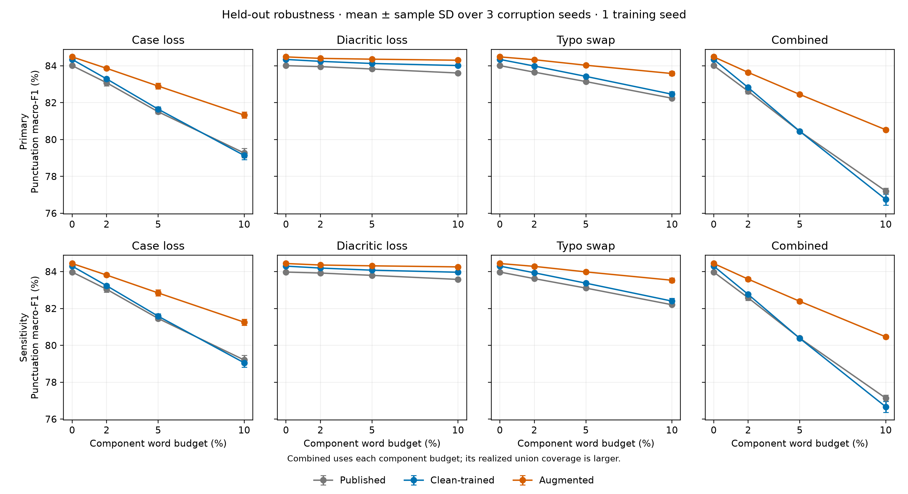
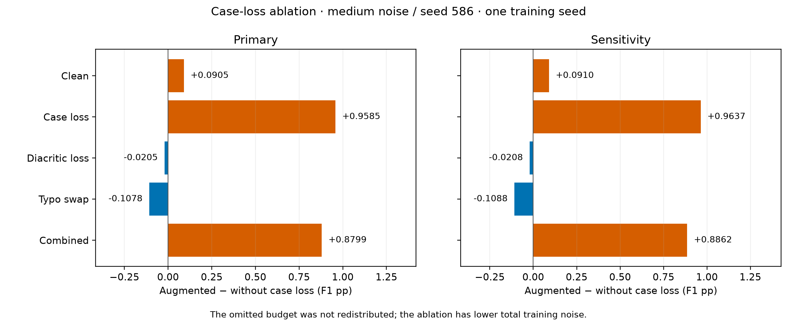

# Held-out test: verified results

Completed **2026-10-23**. All **122 forward conditions / 244 cohort score sets**
were recomputed from original word targets on Colab and independently on the local CPU.
No training or model inference was repeated during analysis.

## Main comparison

On clean primary test text, clean-trained macro-F1 is **84.3437%**
and augmented macro-F1 is **84.4824%**
(augmented − clean **0.1387 pp**).
Under combined-heavy noise, the augmented − clean paired difference is
**3.7787 ± 0.2191 pp** across three corruption seeds.

These are descriptive results for fixed models trained with one training seed.
Means and sample SD (ddof=1) describe corruption realizations only;
clean/full-loss controls and the seed-586 ablation have no estimated seed SD.

## Complete frozen matrix

Punctuation macro-F1 (%) averages PERIOD, COMMA and QUESTION_MARK.
O positions remain in false-positive/negative counts. All planned conditions,
including unfavorable results and full-loss stresses, are reported.
Stochastic main-arm columns are three-seed means ± SD; the ablation column
contains seed586 alone. Use the matched-seed ablation contrasts below,
rather than subtracting that single value from a three-seed mean.

### Primary: 14,600 rows / 181,485 words

| Condition | Published | Clean-trained | Augmented | Without case loss | Augmented − clean (pp) |
| --- | ---: | ---: | ---: | ---: | ---: |
| clean-anchor | 84.0071 | 84.3437 | 84.4824 | 84.3919 | 0.1387 |
| case_loss-mild | 83.0810 ± 0.1646 | 83.2890 ± 0.0821 | 83.8620 ± 0.0832 | Outside frozen scope | 0.5730 ± 0.0935 |
| case_loss-medium | 81.5050 ± 0.1071 | 81.6460 ± 0.1313 | 82.8992 ± 0.1601 | 82.1178 | 1.2532 ± 0.0505 |
| case_loss-heavy | 79.2674 ± 0.2516 | 79.1340 ± 0.2251 | 81.3246 ± 0.1641 | Outside frozen scope | 2.1906 ± 0.0618 |
| diacritic_loss-mild | 83.9539 ± 0.0294 | 84.2402 ± 0.0265 | 84.4018 ± 0.0362 | Outside frozen scope | 0.1617 ± 0.0521 |
| diacritic_loss-medium | 83.8259 ± 0.0420 | 84.1244 ± 0.0272 | 84.3583 ± 0.0273 | 84.3917 | 0.2339 ± 0.0120 |
| diacritic_loss-heavy | 83.6073 ± 0.0365 | 84.0130 ± 0.0574 | 84.3013 ± 0.0579 | Outside frozen scope | 0.2883 ± 0.1080 |
| typo_swap-mild | 83.6547 ± 0.0511 | 83.9855 ± 0.0521 | 84.3291 ± 0.0368 | Outside frozen scope | 0.3436 ± 0.0371 |
| typo_swap-medium | 83.1434 ± 0.0503 | 83.4238 ± 0.0302 | 84.0301 ± 0.0204 | 84.1335 | 0.6063 ± 0.0351 |
| typo_swap-heavy | 82.2406 ± 0.0339 | 82.4574 ± 0.1407 | 83.5796 ± 0.1157 | Outside frozen scope | 1.1222 ± 0.1699 |
| combined-mild | 82.6204 ± 0.1460 | 82.8196 ± 0.0709 | 83.6413 ± 0.0973 | Outside frozen scope | 0.8217 ± 0.1358 |
| combined-medium | 80.4421 ± 0.0866 | 80.4467 ± 0.0665 | 82.4459 ± 0.0919 | 81.6129 | 1.9992 ± 0.0339 |
| combined-heavy | 77.2021 ± 0.1631 | 76.7502 ± 0.3021 | 80.5289 ± 0.0906 | Outside frozen scope | 3.7787 ± 0.2191 |
| case_loss_full | 77.5536 | 77.3370 | 80.2493 | Outside frozen scope | 2.9123 |
| diacritic_loss_full | 82.8649 | 83.5346 | 83.7425 | Outside frozen scope | 0.2079 |

### Sensitivity: 14,445 rows / 181,116 words

| Condition | Published | Clean-trained | Augmented | Without case loss | Augmented − clean (pp) |
| --- | ---: | ---: | ---: | ---: | ---: |
| clean-anchor | 83.9760 | 84.2972 | 84.4389 | 84.3479 | 0.1417 |
| case_loss-mild | 83.0435 ± 0.1675 | 83.2359 ± 0.0830 | 83.8135 ± 0.0839 | Outside frozen scope | 0.5776 ± 0.0941 |
| case_loss-medium | 81.4581 ± 0.1090 | 81.5810 ± 0.1341 | 82.8438 ± 0.1628 | 82.0608 | 1.2628 ± 0.0513 |
| case_loss-heavy | 79.2066 ± 0.2552 | 79.0525 ± 0.2281 | 81.2574 ± 0.1674 | Outside frozen scope | 2.2049 ± 0.0615 |
| diacritic_loss-mild | 83.9227 ± 0.0298 | 84.1933 ± 0.0266 | 84.3576 ± 0.0365 | Outside frozen scope | 0.1643 ± 0.0526 |
| diacritic_loss-medium | 83.7959 ± 0.0422 | 84.0771 ± 0.0272 | 84.3137 ± 0.0276 | 84.3478 | 0.2366 ± 0.0123 |
| diacritic_loss-heavy | 83.5764 ± 0.0372 | 83.9659 ± 0.0590 | 84.2565 ± 0.0586 | Outside frozen scope | 0.2906 ± 0.1101 |
| typo_swap-mild | 83.6204 ± 0.0512 | 83.9366 ± 0.0536 | 84.2849 ± 0.0372 | Outside frozen scope | 0.3483 ± 0.0387 |
| typo_swap-medium | 83.1064 ± 0.0494 | 83.3725 ± 0.0312 | 83.9843 ± 0.0204 | 84.0893 | 0.6117 ± 0.0365 |
| typo_swap-heavy | 82.2034 ± 0.0340 | 82.4017 ± 0.1437 | 83.5321 ± 0.1179 | Outside frozen scope | 1.1304 ± 0.1711 |
| combined-mild | 82.5791 ± 0.1469 | 82.7653 ± 0.0711 | 83.5917 ± 0.0992 | Outside frozen scope | 0.8264 ± 0.1351 |
| combined-medium | 80.3899 ± 0.0892 | 80.3793 ± 0.0707 | 82.3892 ± 0.0932 | 81.5529 | 2.0099 ± 0.0299 |
| combined-heavy | 77.1358 ± 0.1730 | 76.6662 ± 0.3035 | 80.4613 ± 0.0919 | Outside frozen scope | 3.7951 ± 0.2178 |
| case_loss_full | 77.4783 | 77.2415 | 80.1728 | Outside frozen scope | 2.9313 |
| diacritic_loss_full | 82.8310 | 83.4868 | 83.6958 | Outside frozen scope | 0.2090 |

## Case-loss training ablation

These five comparisons use **corruption seed 586 only**, matching the frozen validation scope.
Full augmentation minus the without-case-loss arm is shown below in F1 percentage points.
Removing case loss also lowers total training noise; its budget was not redistributed.
This is not an equal-dose ranking of noise components.

| Condition | Primary augmented − without | Sensitivity augmented − without |
| --- | ---: | ---: |
| clean-anchor | 0.0905 | 0.0910 |
| case_loss-medium | 0.9585 | 0.9637 |
| diacritic_loss-medium | -0.0205 | -0.0208 |
| typo_swap-medium | -0.1078 | -0.1088 |
| combined-medium | 0.8799 | 0.8862 |

Retaining case loss improves primary F1 by **0.9585 pp**
under case loss and **0.8799 pp** under combined noise.
The small diacritic/typo differences favor the ablation. The clean-validation
advantage of removing case loss did not recur on held-out clean text;
the full augmented model has a small positive clean-test difference here.

## Relative drops, classes and fixed diagnostics

The [complete aggregate CSV](held-out-test-aggregates.csv) retains macro/micro and per-class
precision, recall and F1; own-clean-to-noisy drops; and paired model contrasts.
Positive own-clean drop means deterioration. Supports, confusion matrices and every
condition’s realized noise coverage are preserved in the [aggregate condition JSON](held-out-test-condition-summary.json).
The [fixed diagnostic CSV](held-out-test-diagnostics.csv) partitions outcomes into edited
words, unchanged words with edited sentence context, and entirely unchanged rows,
for both cohorts and the prelisted diagnostic conditions. Counts are checked against
the frozen analyzer’s primary outcome totals. Source-ordered raw examples stay outside Git.

The sensitivity cohort removes 155 exact original-input matches to train or validation
(148 train, 90 validation, 83 both). It filters the **same** saved primary predictions;
noise was not regenerated or rebudgeted. It is not a new independent test set or proof
of document separation. Full-loss stresses are separate endpoints, not another 10% dose.

## Method, interpretation and limits

All fine-tuned arms use the same initialization, training rows/order and 3-epoch /
10,968-update budget. Epoch 3 was selected by clean validation; noisy validation and
test scores selected no checkpoints. Published BERT is an external reference with
uncontrolled training history. Actual T4 model tensors, source/input hashes, shared
batch membership and FP32 SDPA/math numerical settings passed the recorded gates.

This protocol was frozen before project test scoring, after validation development;
it is validation-informed, not a blind preregistration. No p-values, equivalence or
training-seed stability claim is supported. Synthetic spelling edits do not cover all
natural informal Turkish or establish semantic invariance. Dataset licensing, exact
split provenance, document independence and published-model prior test exposure
remain unresolved. Future test-informed changes must be labeled exploratory.

## Evidence and retention

- Run identity: `60e31867535de346accb64be45df04984434f6ff328b31c8819115cb689538a0`.
- Analysis identity: `e39f8803a6e6614363a6db97c1edce870757a2e909dec9dba5e93d0d9edc7f91`.
- Original predictions/condition commits: `artifacts/evaluations/held-out-test-v1/`.
- Local CPU analysis, ZIP and verification: `artifacts/evaluation-preparation/held-out-test-v1/completion-2026-10-23/`.
- Results ZIP: **570 source files + manifest**, **16,011,054 bytes**.
- ZIP SHA-256: `2463a23ed22dc9543341393bedfb902f693448330da860374c708748d4830925`.
- Existing training/model archives remain separate. No Drive file was deleted.
- [Execution and archive record](held-out-test-completion.md); [frozen protocol](held-out-test-protocol.md).
