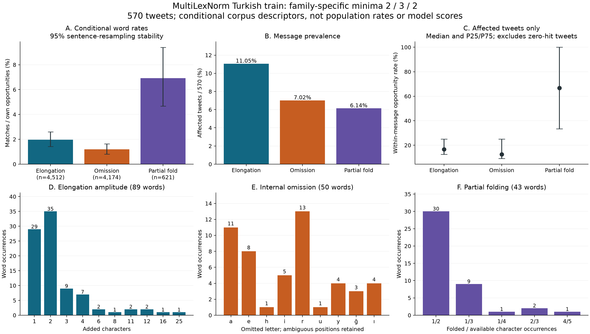
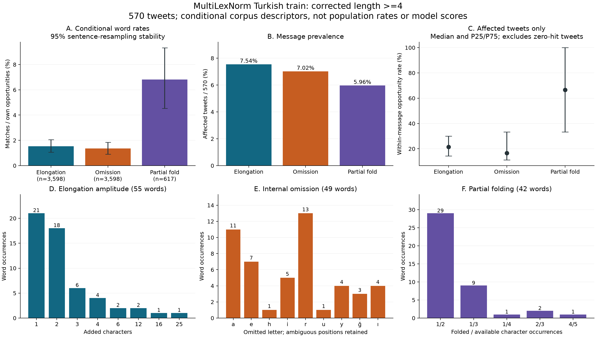

# MultiLexNorm Turkish: density and severity of three unseen shapes

Completed **2026-11-04**. This extends the completed data-only audit; it does
not repeat old reachability, run a model, read source test data, or change the original report.
[Specification](informal-corpus-depth-protocol.md) · [Config](../configs/informal-corpus-depth.json) · [Complete aggregate](informal-corpus-depth-summary.json) · [Original audit](informal-corpus-audit-results.md).

## Latest calibration scope: short words matter

A subsequent, explicitly exploratory length-sensitivity check found that the
initial length>=4 scope omitted **34/89 (38.2022%)** of the alphabetic elongation
shapes. Preserve that completed scope as the comparability analysis below; use
the separately versioned family-specific profile to inform the next recipe.
[All length thresholds](informal-corpus-length-sensitivity.json) · [Full family-specific profile](informal-corpus-calibration-profile.json).

| Minimum corrected length | Common alphabetic pairs | Elongation | Internal omission | Partial folding / multi-foldable pairs |
| --- | ---: | ---: | ---: | ---: |
| 1 | 4557 | 89 | 50 | 43/621 |
| 2 | 4512 | 89 | 50 | 43/621 |
| 3 | 4174 | 72 | 50 | 43/621 |
| 4 | 3598 | 55 | 49 | 42/617 |

The broader profile uses **length>=2 for elongation, >=3 for an interior
omission, and >=2 plus at least two foldable occurrences for partial folding**.
These are family-specific opportunity rules, not changes to training-v1 or its
frozen minimum-swap length. No one-letter elongation match was observed; an
interior omission is structurally impossible below length3.

| Shape | Matches / own opportunities | Conditional rate | Affected tweets /570 | 95% sentence-resampling stability |
| --- | ---: | ---: | ---: | ---: |
| Elongation | 89/4512 | 1.9725% | 63 (11.0526%) | 1.4152%–2.6022% |
| Internal omission | 50/4174 | 1.1979% | 40 (7.0175%) | 0.8017%–1.6319% |
| Partial folding | 43/621 | 6.9243% | 35 (6.1404%) | 4.6774%–9.3899% |

These denominators differ: the rates cannot be added or copied onto all words.
On the **same 4,557 alphabetic one-to-one pairs**, the respective occurrence shares
are **1.9530%, 1.0972%, 0.9436%**. The three shapes affect **182** distinct words
and **131/570 (22.9825%)** tweets. They remain selected patterns, not a complete
taxonomy of informal Turkish. All intervals are conditional stability summaries.

Broader amplitude findings: elongation P25/median/P75 = **1/2/3** extra characters,
P95=11, max25; **77/89** change one run and **12/89** multiple runs. There are
104 changed runs: 62 final, 38 interior, 4 initial. Omission remains exactly one
character: 47 unique and 3 ambiguous alignments, median missing fraction1/7.
Partial folding changes one character in **40/43 (93.0233%)** words; its
folded/available pairs are **1/2:30, 1/3:9, 1/4:1, 2/3:2, 4/5:1**.

In the broader scope too, each family's opportunity-sentence P25, median and P75
are zero. Positive-only density medians are **16.6667%, 12.5%, 66.6667%**
respectively, with a different family-eligible denominator in each tweet. The
partial-fold fraction quartiles still all equal0.5. Do not label these unrelated
quantities as three natural mild/medium/heavy levels.

This broader profile was specified after inspecting length sensitivity and before
any new model scores. The original min4 profile and its uncertainty results remain
unchanged. The next protocol should explicitly select the wider family rules,
retain the whole observed amplitude distribution, and disclose any controlled
stress multipliers or simplification of placement/clustering.

## Initial length>=4 depth analysis: source and denominators

Pinned MultiLexNorm Turkish **train**, 570 sentences / 6,443 source slots.
The strict opportunity pool contains **3,598** one-to-one alphabetic pairs,
corrected length >=4, with unchanged eligible pairs retained. Disjoint exclusions:
354 structural slots, 1,583 remaining slots shorter than four corrected characters,
908 remaining nonalphabetic pairs. The latter categories follow that precedence.
Partial folding has **617** opportunities with at least two foldable occurrences.
The original 6,089 one-to-one slots include punctuation; none of these denominators
is automatically the punctuation-free all-word count in our original experiment.

Rates are conditional on this selected corpus, annotation scheme and eligibility;
they are not population frequencies of informal Turkish. Shapes use Turkish-aware
lowercase comparison, not annotator-provided error categories or judgments of intent.

| Shape | Occurrences | /3,598 common eligible pairs | /Own opportunities | Affected tweets /570 |
| --- | ---: | ---: | ---: | ---: |
| Elongation | 55 | 1.5286% | 55/3598 = 1.5286% | 43 = 7.5439% |
| Internal omission | 49 | 1.3619% | 49/3598 = 1.3619% | 40 = 7.0175% |
| Partial folding | 42 | 1.1673% | 42/617 = 6.8071% | 34 = 5.9649% |

The larger partial-fold opportunity rate reflects its narrower eligibility. Use the
common-pool column for common-denominator comparisons. The three shapes cover
**146** distinct words and **112/570 (19.6491%)** sentences.
There is no same-word overlap between these three length-defined shapes.

## Length>=4: per-word amplitude is different from word exposure

### Elongation

Added-character histogram: `{"1": 21, "2": 18, "3": 6, "4": 4, "6": 2, "12": 2, "16": 1, "25": 1}`.
Median **2**, P25 **1**, P75 **3**, P95 **12**, maximum **25**; mean **3.0545** added characters. The five largest words account for **42.2619%** of all 168 added characters.
A mean-only or a fixed +1-character recipe would hide this tail.

**48/55 (87.2727%)** cases change one run, **5** change two and **2** change three.
Across 64 changed runs: **32 final, 31 interior, 1 initial**; **32/64** repeat vowels.
Do not confuse run counts with word counts. A one-run-only generator would represent
48 observed cases and should use **48/3,598**, not the full 55-case rate.

### One internal omission

All **49** detected words omit **exactly one** interior character by definition.
Corrected word-length median **7**, range **4–13**; the missing fraction has P25
**11.1111%**, median **14.2857%**, P75 **16.6667%** and maximum **25%**.
These describe relative word damage, not evidence for two/three deletions per word.
There are **46** unique positional alignments and **3** ambiguous repeated-character
alignments. Position statistics use only the 46 unique cases; median relative index
is **0.6** on index/(length−1). **28/49** omitted letters are vowels; most frequent
letters are `r`13, `a`11, `e`7. These are surface observations, not inferred causes.

### Partial Turkish folding

Folded/available occurrence histogram: `{"1/2": 29, "1/3": 9, "1/4": 1, "2/3": 2, "4/5": 1}`.
**39/42 (92.8571%)** words fold one character; two words fold two, one folds four.
**29/42** are exactly 1-of-2. The folded fraction has **P25 = median = P75 = 50%**,
range **25–80%**. In total **47/100** available character occurrences in these
42 affected words are folded; this is a character-weighted ratio, not the
mean per-word fraction (47.3413%).

Within all 617 multi-foldable opportunities: **270** full folds, **42** partial folds,
**230** case-neutral unchanged and **75** other changes. Thus partial folds are
**42/312 (13.4615%)** of these literal full-or-partial folding patterns.

## Tweet density, zeros and concentration

Rates below use each sentence's family-eligible word count. Positive-only quantiles
condition on the family occurring; they must not be applied to every sentence.

| Shape | Opportunity-bearing tweets | Zero-hit tweets among them | Positive-only rate P25 / median / P75 | Max hits in one tweet | Top-five tweet share of all hits |
| --- | ---: | ---: | ---: | ---: | ---: |
| Elongation | 566 | 523 | 14.2857% / 21.4286% / 30.0000% | 3 | 25.4545% |
| Internal omission | 566 | 526 | 11.1111% / 16.6667% / 33.3333% | 5 | 28.5714% |
| Partial folding | 356 | 322 | 33.3333% / 66.6667% / 100.0000% | 4 | 28.5714% |

For **every family**, all-opportunity-sentence P25, median, P75 and even P90
are **zero**. It would be misleading to manufacture three positive mild/medium/heavy
doses from those quantiles. Positive-only partial-fold density can be high because
there may be only one or two eligible words in the affected tweet.

Sentence memberships: elongation only38, omission only36, partial folding only33,
elongation+omission4, elongation+partial folding1, none458. No omission+partial
folding or all-three sentence occurs in this selected sample. Among the 112 new-shape
sentences, **63 (56.25%)** also contain an exact old-operator-reachable pair elsewhere
(**48** using case-neutral reachability). This is co-occurrence, not evidence of
actual historical sampled training exposure.

## Resampling stability, duplication and scope

5,000 whole-sentence bootstrap draws, PCG64 seed586; 95% percentile stability
intervals. Every family has 5,000 defined replicates and zero undefined replicates.
These do not establish population confidence, training uncertainty or significance.

| Shape | Pooled opportunity rate | Sentence-bootstrap stability interval | Neutral unique-pair matches / opportunities | Unique-pair rate |
| --- | ---: | ---: | ---: | ---: |
| Elongation | 1.5286% | 1.0565%–2.0540% | 53/2764 | 1.9175% |
| Internal omission | 1.3619% | 0.9129%–1.8513% | 41/2764 | 1.4834% |
| Partial folding | 6.8071% | 4.5383%–9.3169% | 40/560 | 7.1429% |

Unique pairs are a reweighting, not independent observations. Complete aggregate
JSON also contains exact-pair sensitivity, length strata, leave-one-sentence-out
ranges, letter/position histograms and exact versus case-neutral edit distances.

The three shapes cover **146/732 (19.9454%)** of the previous audit's case-neutral
unreachable one-word changes. The restricted 3,598-pair pool separately contains
2,343 unchanged, 786 old-reachable, 146 new-shape and 323 other-unreachable pairs.
These selected mechanisms do not exhaust informal Turkish or all uncovered errors.

## Consequences for the next evaluation

1. The primary extension should measure the three new mechanisms separately, with
   fixed existing models and a fresh clean anchor. Preserve the completed old grid;
   do not rerun it merely to add the extension.
2. Specify an empirically anchored condition per family using the stated opportunity
   denominator and a declared distribution of amplitude/placement. Decide explicitly
   whether to retain multi-run elongation and sentence clustering; simplifying them
   changes what the rate means. Do not copy these percentages onto all word slots.
   Keep folded/available joint support valid; unobserved word/run shapes need a
   declared adaptation rule, not independent sampling of incompatible marginals.
3. Include a small **seen-mechanism control**, particularly full folding on the same
   selected multi-foldable words as partial folding. It matches word exposure while
   changing character dose. Historical case/swap/combined results remain references.
   This matched control has a new input identity; old full-fold predictions cannot
   be reused as if they were generated on this newly selected pool.
4. Do not force three natural severity levels. Extra-character intensity supports
   lower/middle/upper descriptive bins of 21/24/10 words (thresholds1,3); omission
   always removes one character; partial-fold fraction quartiles collapse at0.5
   and give 39/0/3 words. Additional dose multipliers or mixed-noise conditions must
   be explicitly labeled controlled stress scenarios, chosen before model scores.
5. A mixed seen+new condition could address co-occurrence, but uniform addition of
   old 5% per-family noise would not reproduce the observed joint distribution.
   Freeze any such secondary condition separately rather than silently enlarging
   the matrix or asserting natural realism.

No evaluation recipe is frozen by these findings; no corrupted model input or score
has been generated. Existing 2/5/10% recipes and final report PDFs are unchanged.
New corruptions on old test text are supplemental controlled transfer, with shared
sentences/targets. Licensing/exact provenance, model historical exposure and
population generalization remain unresolved. This corpus supplies no punctuation gold.

## Reproducibility

Depth identity: `cde287765953c12dc78f4f56d0eca6ec81c017d21dd10626f3f9fffc7d161cca`.
Original audit: `31b1594e88c80d0607436a008a7b1a6e9bd74c67452eb73dcf0424a69a56aa7a`.
Length-sensitivity identity: `1bd0abe5b1d6542d4a5b138ae5c1d8c3f8b2fc35cf3b835e832a1f9d7229703c`.
Broader calibration identity: `f8b903a57451c895712c7a7e71bb7061a02dbeeff123cf3efe4b58605f15039f`.
Private immutable run: `artifacts/corpus-audit/multilexnorm-depth-v1/depth-cde287765953c12d/`.
The public aggregate is byte-identical to its saved summary. Private slot/sentence
features contain IDs/hashes/measurements, no full words or tweets. The original
audit manifest and source bytes were verified; no old reachability was rerun.
See the local verification/publication receipts for actual conservation, source
hash and figure review outcomes. No unit suite or model was run.
