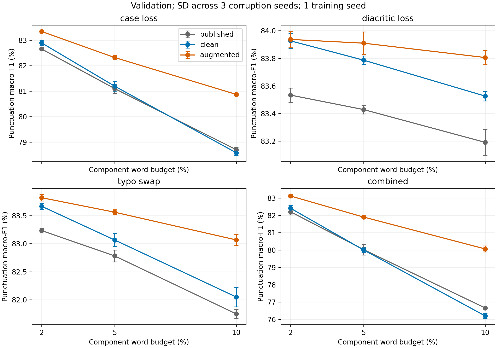
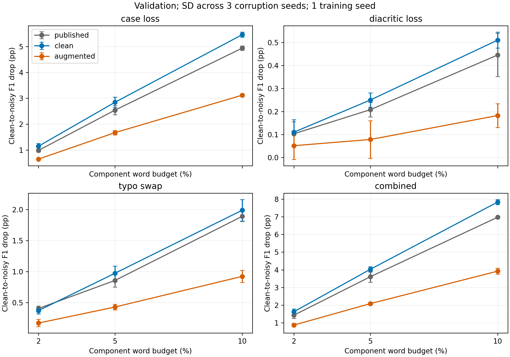

# Validation robustness grid: three fixed BERT models

Completed **2026-10-22** on Tesla T4, from source commit
`085065f5203c63467321db7f5e5bbfb5b2158c45`. The
[prespecified protocol](robustness-grid.md) fixes the models, 2/5/10% component
word budgets, corruption seeds 586/587/588 and 39 conditions per model.
All **117 evaluations** finished; saved word predictions were checked against
14,453 original validation records / 179,164 word targets per condition.

## Comparison and scope

The main comparison is **augmented versus clean fine-tuning**, with the same
initialization, optimization and training budget. Both selected epoch-03 models
were fixed before this grid. The published checkpoint is an external reference
with a different, uncontrolled training history. No training updates or checkpoint
selection from noisy scores occurred in this step. The primary score is macro-F1
over PERIOD, COMMA and QUESTION_MARK; O remains in the confusion counts but is
excluded from this three-class average. F1 is shown as a percentage; differences
are percentage points (pp).

Every curve uses its own **fresh GPU clean control**, with matched input order,
batches, FP32 numerics and runtime. Historical CPU results are not substituted.
Means and sample SD below vary **corruption realization only**, using three seeds.
One fine-tuning seed is available. These are descriptive validation results,
not significance tests, training-seed stability estimates or held-out test results.
This validation split was also used to select checkpoints on clean data.

## Clean controls

| Model | Macro precision | Macro recall | Macro-F1 | Micro-F1 |
| --- | ---: | ---: | ---: | ---: |
| published | 86.0549 | 81.7684 | 83.6366 | 82.6651 |
| clean | 86.0306 | 82.4744 | 84.0365 | 82.9874 |
| augmented | 85.7945 | 82.6040 | 83.9881 | 83.0790 |

Augmented minus clean macro-F1 is **-0.0485 pp** on clean text. This
observed small trade-off is not evidence of statistical equivalence.

## Severity and corruption seeds

Cells are **mean ± sample SD** across the three corruption seeds. The paired
delta uses the same corruption seed on both fine-tuned models.

| Noise family | Severity | Published F1 | Clean F1 | Augmented F1 | Augmented − clean (pp) |
| --- | --- | ---: | ---: | ---: | ---: |
| case_loss | mild | 82.6512 ± 0.0612 | 82.8895 ± 0.1046 | 83.3375 ± 0.0090 | 0.4480 ± 0.0994 |
| case_loss | medium | 81.0979 ± 0.1781 | 81.1932 ± 0.1973 | 82.3168 ± 0.0859 | 1.1236 ± 0.1694 |
| case_loss | heavy | 78.6990 ± 0.0889 | 78.5788 ± 0.0989 | 80.8687 ± 0.0576 | 2.2899 ± 0.1022 |
| diacritic_loss | mild | 83.5335 ± 0.0519 | 83.9265 ± 0.0542 | 83.9367 ± 0.0592 | 0.0102 ± 0.1125 |
| diacritic_loss | medium | 83.4288 ± 0.0317 | 83.7868 ± 0.0309 | 83.9098 ± 0.0819 | 0.1231 ± 0.1023 |
| diacritic_loss | heavy | 83.1911 ± 0.0937 | 83.5263 ± 0.0349 | 83.8057 ± 0.0518 | 0.2794 ± 0.0179 |
| typo_swap | mild | 83.2325 ± 0.0387 | 83.6663 ± 0.0524 | 83.8190 ± 0.0585 | 0.1527 ± 0.0248 |
| typo_swap | medium | 82.7812 ± 0.1068 | 83.0653 ± 0.1166 | 83.5607 ± 0.0443 | 0.4954 ± 0.1455 |
| typo_swap | heavy | 81.7470 ± 0.0811 | 82.0480 ± 0.1729 | 83.0663 ± 0.0988 | 1.0183 ± 0.1331 |
| combined | mild | 82.2044 ± 0.1728 | 82.4087 ± 0.1614 | 83.1146 ± 0.0919 | 0.7059 ± 0.0874 |
| combined | medium | 80.0281 ± 0.3083 | 80.0089 ± 0.1519 | 81.9016 ± 0.0848 | 1.8926 ± 0.1412 |
| combined | heavy | 76.6618 ± 0.0270 | 76.2023 ± 0.1449 | 80.0646 ± 0.1739 | 3.8623 ± 0.0512 |

Panels use different y-axis scales; compare numeric drops rather than apparent
slopes across noise families.

### Observations

- **Case loss is the most damaging single family at every matched component
  budget.** At heavy dose, clean-model F1 is 78.5788 under case loss, 82.0480
  under swaps and 83.5263 under diacritic loss.
- **Augmentation gains increase with dose in this grid.** Heavy-dose gains are
  +2.2899 pp for case loss, +0.2794 for diacritic loss, +1.0183 for swaps and
  +3.8623 for combined. The medium combined gain is +1.8926 pp.
- **Mild diacritic loss has almost no average gain:** +0.0102 ± 0.1125 pp.
  Its seed-588 delta is negative (−0.1128 pp). The broad macro improvement does
  not mean every dose, corruption realization or punctuation class improves.
- **Combined uses a larger changed-word coverage.** Its realized union is about
  5.89–5.91% / 14.33–14.35% / 27.33–27.38% at mild/medium/heavy, compared with
  2/5/10% for a single family. Its larger damage or gain alone cannot establish
  an interaction/synergy effect or an equal-dose ranking against single families.

## Punctuation classes and precision/recall

The following are mean **per-class F1 gains (augmented − clean, pp)** at heavy dose.
The underlying reports retain precision, recall, F1, supports and confusion
matrices for every one of the 117 evaluations.

| Heavy noise | Period ΔF1 | Comma ΔF1 | Question ΔF1 |
| --- | ---: | ---: | ---: |
| case_loss | +0.3392 | +4.8128 | +1.7178 |
| diacritic_loss | -0.0459 | +1.0554 | -0.1713 |
| typo_swap | +0.0436 | +2.6328 | +0.3783 |
| combined | +0.6846 | +7.8021 | +3.1002 |

**Comma accounts for the largest gains.** Under combined-heavy, its mean recall
rises from **41.3346% to 53.7358%**, while precision falls from **64.6037% to
63.5110%**. Comma F1 rises from 50.4136% to 58.2157%: recovery of more true commas
comes with more false insertions. Period and question F1 also improve there.
Under diacritic-heavy, however, period and question F1 decrease by 0.0459 and
0.1713 pp. Clean-text question F1 is also 0.4346 pp lower for the augmented model.
A better macro-F1 therefore does not imply a uniform class benefit.

## Separate full-loss stress endpoints

These deterministic endpoints have no corruption-seed SD. Coverage counts words
whose spelling actually changes, so they are not matched to one another or to
the heavy-dose conditions.

| Endpoint | Changed words (%) | Published F1 | Clean F1 | Augmented F1 | Augmented − clean (pp) |
| --- | ---: | ---: | ---: | ---: | ---: |
| case_loss_full | 13.3453 | 77.0306 | 76.5958 | 79.7858 | +3.1900 |
| diacritic_loss_full | 41.9002 | 82.4441 | 82.9752 | 83.0703 | +0.0951 |

## Interpretation and next experiment

The results are consistent with greater reliance on casing cues than on the
other two word perturbations in this setup. Earlier paired error inspection
found casing effects at unchanged words with edited context; see the
[medium pilot error analysis](augmented-noise-pilot.md#paired-errors-and-contextual-sensitivity).
This is an interpretation supported by the observed pattern, not a controlled
causal isolation of one contextual cue. Synthetic swaps/folding also do not
represent every kind of real informal Turkish writing.

The next planned experiment is the **training ablation without case loss**,
already specified in the [training protocol](training-protocol.md#7-seeds-ablations-and-affordable-execution).
Keep the same initialization, rows, updates and remaining word plans; omit case
loss without reallocating its budget. Its clean and four medium/seed-586
evaluations will help separate the value of the casing augmentation component.
This ablation has **not** been trained. Held-out test evaluation remains
unperformed; dataset licensing and exact source/split provenance remain open.

## Verification and stored outputs

The completed grid includes three run directories, fixed source/config snapshots,
117 prediction/metric/example/commit directories and a shared analysis directory.
The analyzer recomputed all saved metrics from original targets, then checked
cross-model inputs, runtime and source identity before publishing figures and
mean/SD summaries. A downloaded archive and local verification provide a second
copy of this evidence; exact verification status is recorded in the operational
[grid status](robustness-grid.md#current-status).

Archive: **533 files**, **15,740,950 bytes** (about 15.7 MB), SHA-256
`30712c7dcd36684d20708eddf5c6671dfafe569737e87f3079004b37ad4caf32`.
It contains evaluation outputs only, no model weights or optimizer state.
Raw text, predictions and large artifacts stay outside Git. The committed
PNG/PDF figures and this report contain aggregate results.
